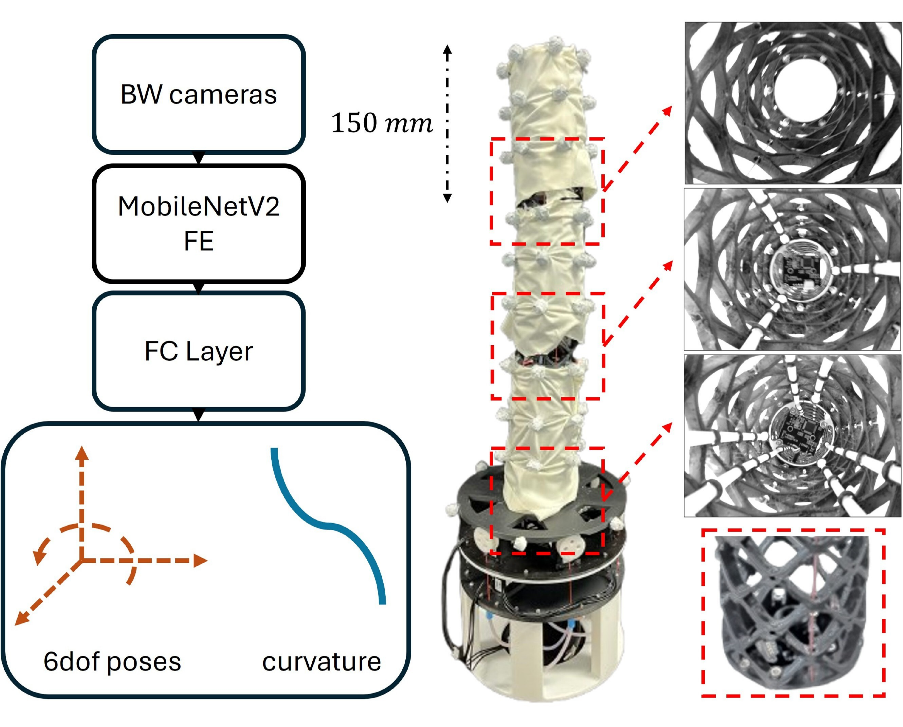
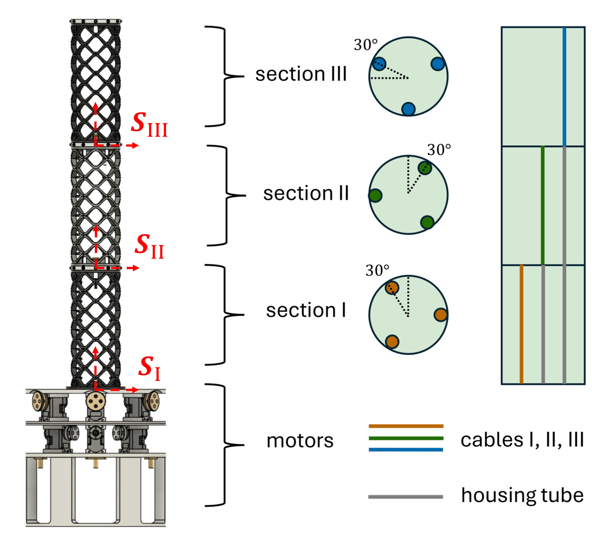
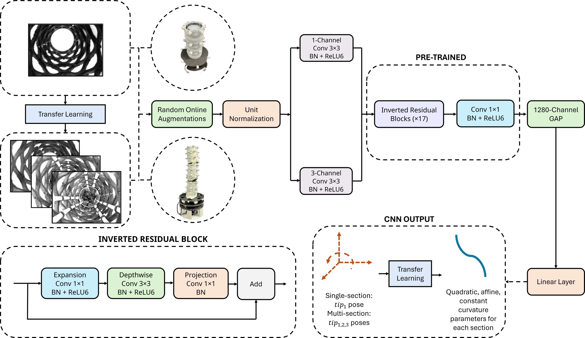
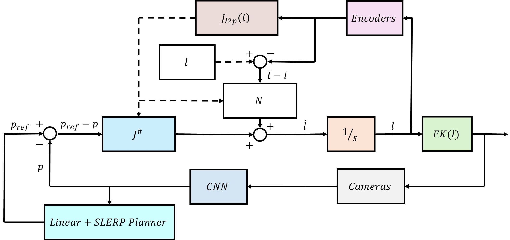
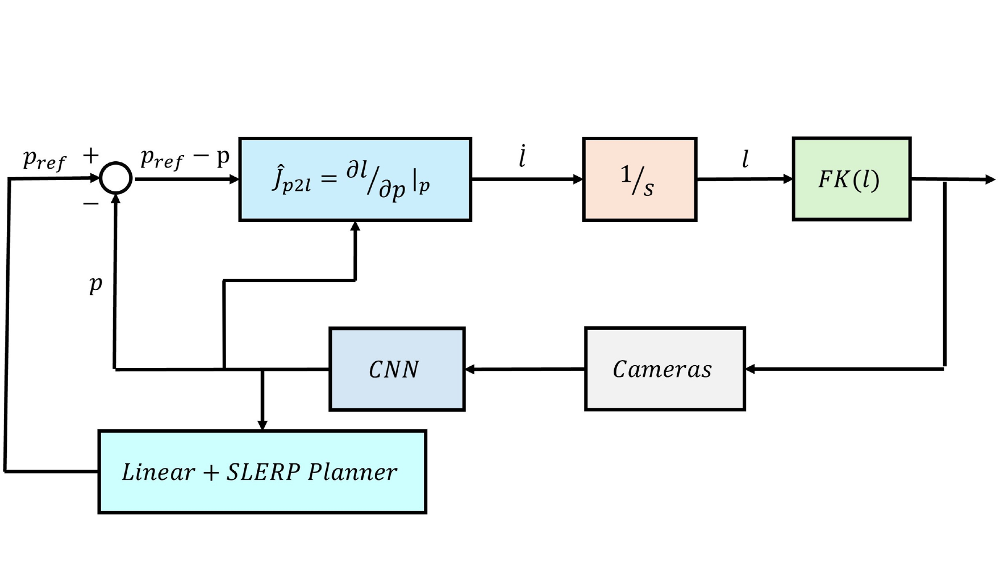
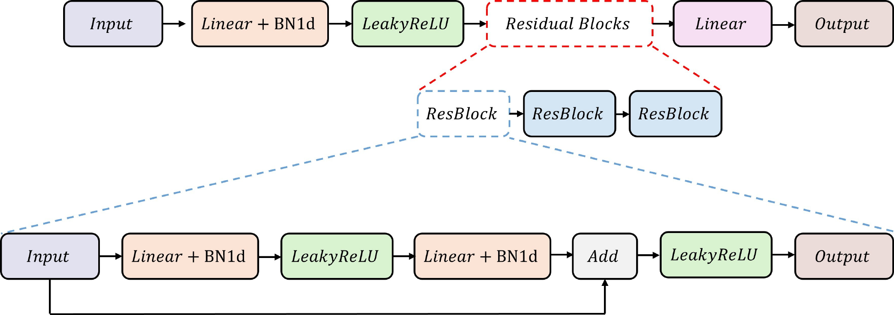

# Internal Camera-based Reconstruction and Closed-loop Control of Soft Robotic Arms

Code for the paper **Internal Camera-based Reconstruction and Closed-loop Control of Soft Robotic Arms** by L. Vignoli, G. Pei, F. Braghin, J. Hughes.

**[Dataset](https://doi.org/10.5281/zenodo.20138549):** The dataset used in this work is available on Zenodo.

<table align="center"><tr>
<td></td>
<td></td>
</tr></table>

<p align="center"><em>(a) Sensorisation and reconstruction pipeline: embedded cameras feed CNNs that predict tip poses and section curvatures. (b) Tendon-driven multi-section arm, three independent segments with three motors each; sections II and III are routed via Bowden cables.</em></p>

Vision-based framework for distributed state estimation and closed-loop control of tendon-driven soft robotic arms. Cameras embedded in each section feed CNNs that regress tip pose and polynomial curvature (constant, affine, quadratic). Two controllers are evaluated: a model-based null-space velocity controller built on the Piecewise Constant Curvature (PCC) model, and a data-driven inverse kinematics network with secondary-objective regularisation. Tested on single- and multi-section manipulators, in open- and closed-loop, with and without external disturbances.

---

## Robot

Continuum manipulator built on a Trimmed Helicoid (TH) structure, actuated by cable tendons. Each section is parameterised by curvature coordinates $q = [\Delta_x, \Delta_y, L]^T$ (lateral deflections and central length). Tendon-length changes $\delta\ell$ [mm] (variable `DELTAL` in code) map to Dynamixel encoder ticks via $u = 4096/(\pi D_{\text{pulley}})$.

| | SINGLE | MULTI |
|---|--------|-------|
| Sections | 1 | 3 |
| Motors | 3 (IDs 1–3) | 9 (IDs 11–19) |
| Cameras | 1 USB | 3 USB (threaded) |
| Actuation DoF | 3 | 9 |
| Tip pose DoF | 6 | 6 |

---

## Sensing & Reconstruction

**Tip pose** is regressed by `helyx_model.pt` from stacked grayscale frames (one per section). **Section curvature** is regressed by dedicated CNNs for the constant, affine, and quadratic polynomial curvature models of each section. For the single-section arm, curvature labels are obtained by fitting these polynomials to OptiTrack backbone-marker rotations via CasADi/IPOPT. For the multi-section arm, marker occlusion prevents tracking the full backbone, so the labels are generated by the surrogate MLP $N_C$ (`*_for_MULTI_model.pt`) trained on single-section data: the multi-section curvature results measure agreement with this model-constrained reference, while the section-tip poses are measured directly by motion capture.

<p align="center">

</p>

<p align="center"><em>CNN architecture for tip-pose and section-curvature estimation. Stacked grayscale images go through online augmentations and a 1- or 3-channel input convolution (Conv 3×3, BN, ReLU6), then a fine-tuned MobileNetV2 backbone with 17 inverted residual blocks and a Conv 1×1 layer. GAP and a linear head regress tip poses or per-section curvature parameters, with a dedicated network for each output. Transfer learning is applied between the pose and curvature networks of the same arm; the SINGLE and MULTI networks are initialised independently from ImageNet weights.</em></p>

---

## Control

Two Jacobian-based strategies. The **analytic Jacobian** is symbolic, derived with SymPy from the PCC model and evaluated numerically. The **data-driven Jacobian** is obtained via `torch.autograd.functional.jacobian` on the learned IK network. In MULTI, the model-based controller projects the secondary objective (mean tendon configuration) through the analytic null space; the data-driven controller bakes the same objective into training via a Lagrangian term.

<table align="center"><tr>
<td></td>
<td></td>
</tr></table>

<p align="center"><em>Multi-section closed-loop control schemes with camera feedback. (a) Model-based controller with null-space optimisation toward the mean tendon configuration. (b) Data-driven controller using the learned inverse Jacobian; no encoder feedback.</em></p>

The forward and inverse kinematics networks of the data-driven path share a residual MLP backbone:

<p align="center">

</p>

<p align="center"><em>MLP architecture for kinematics approximations. Inputs are projected into a 128-dim latent space and processed through three residual blocks (Linear + BatchNorm1d + LeakyReLU ×2, skip), followed by a linear regression head.</em></p>

---

## Repository Structure

```
VisionSoftControl/
│
├── SINGLE/
│   ├── SINGLE_jacobians.py              # Symbolic Jacobians: q → tendon, q → pose
│   ├── SINGLE_kinematics.py             # Iterative mappings: tendon ↔ curvature ↔ pose
│   ├── SINGLE_reconstruction_utility.py # Curvature reconstruction (CasADi/IPOPT)
│   ├── SINGLE_controller.py             # SINGLEController (closed-loop), SINGLEOpenLoop
│   ├── SINGLE_data_acquire.py           # Random motor sampling + mocap/camera capture
│   ├── SINGLE_control_test.py           # Polygon tracking and workspace sampling
│   ├── SINGLE_plot_polygon.py           # Polygon waypoint visualisation
│   ├── SINGLE_try_motion.py             # Random workspace exploration
│   ├── SINGLE_helyx_training.ipynb      # Model training
│   ├── SINGLE_helyx_testing.ipynb       # Model evaluation
│   ├── SINGLE_control_results.ipynb     # Control result analysis
│   ├── SINGLE_polygon_figures.ipynb     # Triangle, square, hexagon tracking (SI Figs. S7-S9)
│   ├── SINGLE_path_error_metrics.ipynb  # RMS radial/height errors of the circles (SI Table S14)
│   ├── SINGLE_revision_figures.ipynb    # Per-sample test errors (results/revision_single_test.npz)
│   ├── SINGLE_test_reconstruction.ipynb # Tip-pose errors on a seeded test split, error vs. bending
│   ├── SINGLE_workspace_coverage.ipynb  # Bending range of control targets vs. training data (SI Table S10)
│   ├── data/                            # Workspace samples (Workspace.npz)
│   ├── models/                          # Pre-trained networks (vision, curvature, kinematics)
│   └── results/                         # Control logs (.npz), metrics (.json), figures (.pdf)
│
└── MULTI/
    ├── MULTI_jacobians.py               # Symbolic Jacobians: q → tendon, q → pose, q → xyz
    ├── MULTI_kinematics.py              # Iterative mappings: tendon ↔ xyz ↔ curvature
    ├── MULTI_reconstruction_utility.py  # Curvature reconstruction (analytical + ANN)
    ├── MULTI_cameras_utility.py         # ThreadedCameraSystem for 3 concurrent cameras
    ├── MULTI_controller.py              # MULTIController, MULTIOpenLoop, NullSpaceCheck
    ├── MULTI_data_acquire.py            # Concurrent acquisition: cameras + mocap + curvature
    ├── MULTI_control_test.py            # Evaluation suite (9 test modalities)
    ├── MULTI_curvature_checks.py        # ANN vs. analytical curvature validation
    ├── MULTI_FK_acquire.py              # Forward kinematics dataset collection
    ├── MULTI_try_motion.py              # Random and Jacobian-guided motion exploration
    ├── MULTI_helyx_training.ipynb       # Model training
    ├── MULTI_helyx_testing.ipynb        # Model evaluation
    ├── MULTI_control_results.ipynb      # Control result analysis
    ├── MULTI_paired_comparison.ipynb    # Target-by-target comparison of the controllers, both arms (SI Table S13)
    ├── MULTI_path_error_metrics.ipynb   # RMS radial/height errors of the circles (SI Table S14)
    ├── MULTI_nullspace_ablation.ipynb/.py # Null-space term on/off, simulated on the PCC model (SI Table S15)
    ├── MULTI_redundancy_pairs.ipynb     # Measured configurations with the same tip pose (SI Fig. S10)
    ├── MULTI_per_point_errors.ipynb     # Curvature error per reference point, both arms (SI Fig. S11)
    ├── MULTI_revision_figures.ipynb     # Per-sample test errors, IK secondary-term ablation (SI Table S16)
    ├── MULTI_test_reconstruction.ipynb  # Absolute/relative tip errors, median and IQR (SI Section 6.2)
    ├── MULTI_workspace_coverage.ipynb/.py # Bending range of control targets vs. training data (SI Table S10)
    ├── data/                            # Workspace samples (.npz), FK/IK dataset FKdata.pt
    ├── models/                          # Pre-trained networks (vision, curvature, kinematics)
    └── results/                         # Control logs (.npz), metrics (.json), figures (.pdf)
```

### Pre-trained models

| File | Description |
|------|-------------|
| `helyx_model.pt` | CNN: grayscale image(s) → tip pose ($f_p^1$ or $f_p^3$) |
| `FK_model.pt` | Forward kinematics MLP $N_p^3$: $\delta\ell$ → tip pose (MULTI) |
| `IK_model.pt` | Inverse kinematics MLP $N_\ell^3$ with null-space regularisation: tip pose → $\delta\ell$ (MULTI) |
| `const_model.pt` (SINGLE), `constant_model.pt` (MULTI) / `affine_model.pt` / `quadratic_model.pt` | Polynomial curvature CNNs ($f_C^1$ for SINGLE, $f_C^3$ for MULTI) |
| `kinematics_model.pt` | Inverse kinematics MLP $N_\ell^1$: tip position → $\delta\ell$ (SINGLE) |
| `*_for_MULTI_model.pt` | Curvature surrogate $N_C$ (one per polynomial model), trained on single-section data; generates the MULTI curvature labels |
| `DELTAL_stats.pt` | Mean tendon vector $\bar\ell$ (mid-range) of the MULTI secondary objective, and its standard deviation |

### Data

- **In this repository:** the recorded control experiments (targets, motion-capture tip poses, tracked circles and polygons, with and without the 50 g payload) as `.npz` archives in `SINGLE/results/` and `MULTI/results/`; the sampled workspaces in `SINGLE/data/Workspace.npz` and `MULTI/data/Workspace.npz`; the 10,000 measured tendon/tip-pose pairs used to train $N_p^3$ and $N_\ell^3$ in `MULTI/data/FKdata.pt`; and the per-sample test errors (`results/revision_*_test.npz`).
- **On [Zenodo](https://doi.org/10.5281/zenodo.20138549):** the raw image datasets with their pose and curvature labels, `SINGLE_dataset.zip` and `MULTI_dataset.zip`. The training and testing notebooks read the shards (`Dataset*.pt`, `DatasetMulti*.pt`) from the arm folder; the other notebooks read them from `data/SINGLE_dataset/` and `data/MULTI_dataset/`.

---

## Setup

### Hardware

| Component | Specification |
|-----------|---------------|
| Actuators | DYNAMIXEL XL330-M288-T, Protocol 2.0, 57600 baud, `/dev/ttyUSB0` |
| Pulley diameter | 6 mm |
| SINGLE motors | IDs 1–3, tendon angles 0°, 120°, −120° |
| MULTI motors | IDs 11–19 (three groups of three; sections II/III via Bowden cables) |
| Cameras | USB grayscale, 480 × 640 (OpenCV V4L2 backend) |
| Motion capture | OptiTrack Prime 13 ×6, via ROS `geometry_msgs/PoseStamped` topics |

Lengths in millimetres, angles in radians.

### Dependencies

```
numpy
torch >= 2.0
torchvision
opencv-python
scipy
sympy
casadi
scikit-learn
dynamixel-sdk
rospy        # ROS Noetic
plotly
matplotlib
```

ROS Noetic must be sourced. Before each session:

```bash
roslaunch optitrack_ros_communication optitrack_nodes.launch
v4l2-ctl --list-devices
```

---

## Usage

All scripts run from inside `SINGLE/` or `MULTI/`. Motor calibration is interactive (`w`/`s`/`h` keys, adaptive acceleration); MULTI camera-to-section assignment is also interactive.

### Data collection

```bash
# SINGLE: random ΔDELTAL sampling with camera + mocap (10,000 samples)
python SINGLE_data_acquire.py

# MULTI: concurrent camera + mocap acquisition with per-batch confirmation
python MULTI_data_acquire.py

# MULTI: FK dataset (ΔDELTAL → tip pose) for IK training
python MULTI_FK_acquire.py
```

### Model training and evaluation

```bash
# SINGLE
jupyter notebook SINGLE_helyx_training.ipynb
jupyter notebook SINGLE_helyx_testing.ipynb

# MULTI
jupyter notebook MULTI_helyx_training.ipynb
jupyter notebook MULTI_helyx_testing.ipynb
```

### Control evaluation

```bash
# SINGLE: closed/open-loop tracking of circles, triangles, squares and hexagons, and workspace sampling
python SINGLE_control_test.py
jupyter notebook SINGLE_control_results.ipynb

# MULTI: interactive suite (closed/open-loop × data-driven/Jacobian × null-space check)
python MULTI_control_test.py
jupyter notebook MULTI_control_results.ipynb

# MULTI: analytical vs. ANN curvature validation
python MULTI_curvature_checks.py
```

The 50 g payload experiment is run by setting `WEIGHT = True` at the top of [`MULTI_control_test.py`](MULTI/MULTI_control_test.py) and re-running the workspace and polygon modalities.

### Supporting Information analyses

These notebooks recompute the corresponding Supporting Information figures and tables without hardware, from the data in this repository (marked *: also the Zenodo dataset):

| Notebook | Output |
|----------|--------|
| [`SINGLE_polygon_figures.ipynb`](SINGLE/SINGLE_polygon_figures.ipynb) | Figs. S7–S9: triangle, square and hexagon tracking |
| [`SINGLE_workspace_coverage.ipynb`](SINGLE/SINGLE_workspace_coverage.ipynb), [`MULTI_workspace_coverage.ipynb`](MULTI/MULTI_workspace_coverage.ipynb) | Table S10: bending range of the control evaluation |
| [`MULTI_paired_comparison.ipynb`](MULTI/MULTI_paired_comparison.ipynb) | Table S13: paired comparison of the controllers (Wilcoxon signed-rank) |
| [`SINGLE_path_error_metrics.ipynb`](SINGLE/SINGLE_path_error_metrics.ipynb), [`MULTI_path_error_metrics.ipynb`](MULTI/MULTI_path_error_metrics.ipynb) | Table S14: path errors of the circles |
| [`MULTI_nullspace_ablation.ipynb`](MULTI/MULTI_nullspace_ablation.ipynb) | Table S15: null-space term of the model-based controller |
| [`MULTI_revision_figures.ipynb`](MULTI/MULTI_revision_figures.ipynb)* | Table S16: secondary term in the training of $N_\ell^3$ (retrains the network, about 20 min on CPU); per-sample test errors used by Fig. S11 |
| [`MULTI_redundancy_pairs.ipynb`](MULTI/MULTI_redundancy_pairs.ipynb) | Fig. S10: measured configurations with the same tip pose |
| [`MULTI_per_point_errors.ipynb`](MULTI/MULTI_per_point_errors.ipynb) | Fig. S11: curvature error per reference point |
| [`MULTI_test_reconstruction.ipynb`](MULTI/MULTI_test_reconstruction.ipynb) | Section 6.2: median and interquartile range of the multi-section tip errors (on a test split drawn with `random_state=42`) |

### Utilities

```bash
# Random workspace exploration
python SINGLE_try_motion.py
python MULTI_try_motion.py
```

---

## License

MIT, see [LICENSE](LICENSE).
